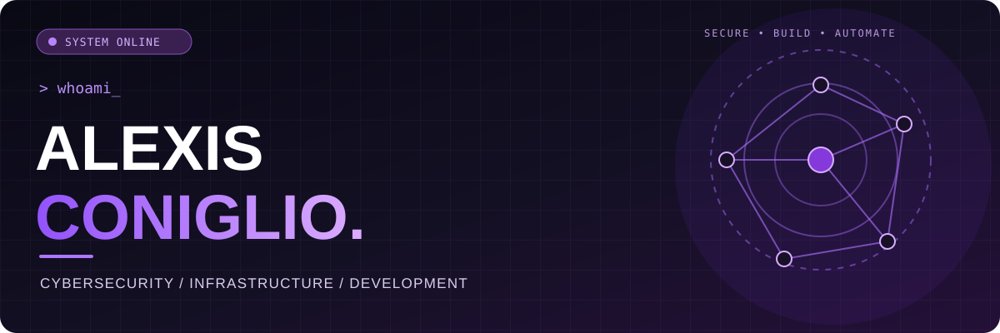
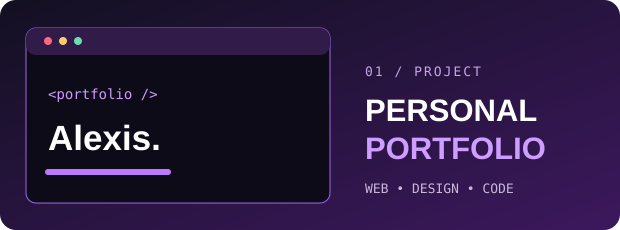

<div align="center">



<br/>


<br/>

<a href="https://github.com/alexis-cgl?tab=repositories"></a>
<a href="https://github.com/alexis-cgl/alexis-coniglio"></a>


<br/><br/>

<sub>⚡ Building • Breaking • Understanding • Securing</sub>

</div>

---

## 

```yaml
name: Alexis Coniglio
role: Cybersecurity & Infrastructure Enthusiast
interests: [Cybersecurity, Networking, Infrastructure, Automation, Web Apps]
mission: "Build it. Understand it. Secure it."
location: France
```

I'm passionate about **cybersecurity, network & systems engineering, and software development**. My favorite projects connect deep technical work with practical tools and polished user experiences.

**En français :** Passionné par la cybersécurité, les réseaux et le développement, j'aime concevoir des outils utiles, administrer des infrastructures et transformer des idées en projets concrets.

<table>
<tr>
<td width="33%" align="center">
<br/>
<br/><br/>
<sub>Security audits • Hardening<br/>Identity & access • Monitoring</sub><br/><br/>
</td>
<td width="33%" align="center">
<br/>
<br/><br/>
<sub>Windows & Linux • Networks<br/>Virtualization • Automation</sub><br/><br/>
</td>
<td width="33%" align="center">
<br/>
<br/><br/>
<sub>Web applications • Frontend<br/>Tooling • User experience</sub><br/><br/>
</td>
</tr>
</table>

## 

**🛡️ Infrastructure / Security**


**💻 Development / Automation**


## 

<div align="center">
<a href="https://github.com/alexis-cgl/alexis-coniglio"></a>

### Personal Portfolio

A personal website showcasing projects, experience and a passion for thoughtful interface design.

<sub>HTML · CSS · Web Design</sub>

<a href="https://github.com/alexis-cgl/alexis-coniglio"><b>VIEW REPOSITORY ↗</b></a>

<br/><br/>
<sub>More projects, experiments and tools are on the way. ✦</sub>
</div>

## 

<div align="center">

<a href="https://github.com/alexis-cgl?tab=repositories"></a>

<br/>

**Contribution grid — purple snake edition**

<picture>
  <source media="(prefers-color-scheme: dark)" srcset="https://raw.githubusercontent.com/alexis-cgl/alexis-cgl/output/github-snake-dark.svg"/>
  <source media="(prefers-color-scheme: light)" srcset="https://raw.githubusercontent.com/alexis-cgl/alexis-cgl/output/github-snake.svg"/>
  
</picture>

<sub>Automatically refreshed by GitHub Actions every day.</sub>

</div>

---

<div align="center">

### `> let's_build_something_great`

*“The best way to understand a system is to build it — and then secure it.”*

<a href="https://github.com/alexis-cgl?tab=repositories"></a>

<br/><br/>


<sub>Designed in black & purple · Made with curiosity ⚡</sub>

</div>
